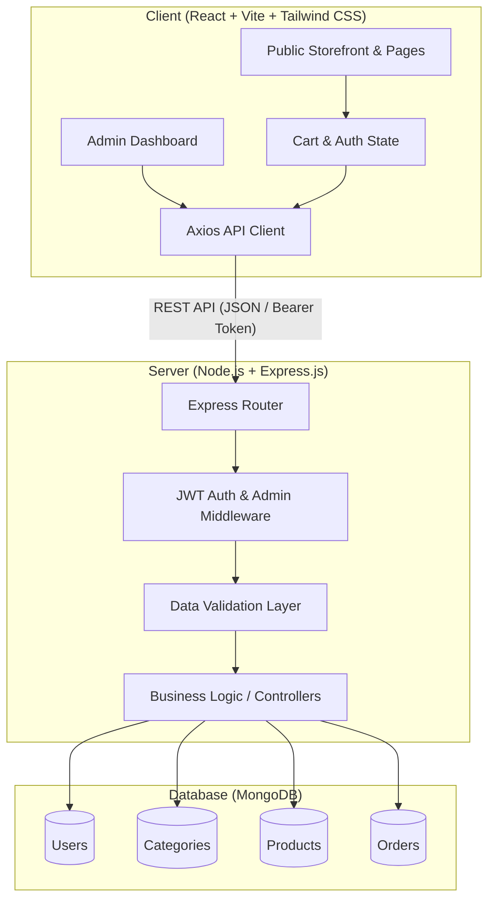

# 🛒 Mini E-Commerce Demo Project (MERN Stack)

A clean, modern, and production-ready **Mini E-Commerce Demo Project** built using the **MERN Stack** (MongoDB, Express.js, React.js, Node.js) with Tailwind CSS, JWT authentication, and Cash on Delivery (COD) order management.

---

## 📑 Table of Contents

- [Overview](#-overview)
- [Tech Stack](#-tech-stack)
- [Project Architecture](#-project-architecture)
- [Project Folder Structure](#-project-folder-structure)
- [Core Features](#-core-features)
  - [1. Authentication & Roles](#1-authentication--roles)
  - [2. Public Storefront](#2-public-storefront)
  - [3. Cart & Checkout](#3-cart--checkout)
  - [4. Admin Panel](#4-admin-panel)
- [Demo Flow](#-demo-flow)
- [Documentation Index](#-documentation-index)
- [Validation & Security Standards](#-validation--security-standards)
- [License](#-license)

---

## 🌟 Overview

This repository contains the complete technical specifications, architectural blueprints, database models, and API definitions for a **Mini E-Commerce Demo Project**. 

The goal of this project is to showcase clean architectural design, separation of concerns, secure authentication, role-based access control, server-side price validation, and a responsive shopping experience without unnecessary enterprise bloat (e.g., no payment gateways, multi-vendor portals, or complex analytics).

---

## 🛠 Tech Stack

| Layer | Technology | Description |
| :--- | :--- | :--- |
| **Frontend** | **React.js (Vite)** | Fast, component-based modern UI development |
| **Styling** | **Tailwind CSS** | Utility-first CSS framework for clean, responsive UI |
| **Backend** | **Node.js + Express.js** | RESTful API server with modular routing and controllers |
| **Database** | **MongoDB + Mongoose** | NoSQL document database with strict schema modeling |
| **Authentication** | **JWT + bcrypt** | Token-based stateless authentication with salted password hashing |
| **HTTP Client** | **Axios** | Promised-based HTTP requests with interceptors |

---

## 🏗 Project Architecture



---

## 📁 Project Folder Structure

The project is structured into two isolated directories: `/client` for the frontend and `/server` for the backend.

```text
spotify/
├── README.md
├── docs/
│   ├── ARCHITECTURE.md
│   ├── API_SPECIFICATION.md
│   ├── DATABASE_MODELS.md
│   ├── AUTHENTICATION_AND_SECURITY.md
│   ├── FRONTEND_SPECIFICATION.md
│   ├── CHECKOUT_AND_ORDERS.md
│   └── PROJECT_SETUP_GUIDE.md
├── client/                      # React Frontend (Vite)
│   ├── index.html
│   ├── vite.config.js
│   ├── tailwind.config.js
│   ├── postcss.config.js
│   ├── package.json
│   ├── .env.example
│   └── src/
│       ├── main.jsx
│       ├── App.jsx
│       ├── index.css
│       ├── api/
│       │   └── axiosInstance.js
│       ├── context/
│       │   ├── AuthContext.jsx
│       │   └── CartContext.jsx
│       ├── components/
│       │   ├── common/
│       │   │   ├── Navbar.jsx
│       │   │   ├── Footer.jsx
│       │   │   ├── Modal.jsx
│       │   │   ├── Toast.jsx
│       │   │   └── ProtectedRoute.jsx
│       │   ├── admin/
│       │   │   └── AdminSidebar.jsx
│       │   └── product/
│       │       ├── ProductCard.jsx
│       │       └── CategoryFilter.jsx
│       └── pages/
│           ├── Home.jsx
│           ├── Products.jsx
│           ├── ProductDetails.jsx
│           ├── Cart.jsx
│           ├── Checkout.jsx
│           ├── Login.jsx
│           ├── Register.jsx
│           ├── MyOrders.jsx
│           └── admin/
│               ├── AdminDashboard.jsx
│               ├── AdminCategories.jsx
│               ├── AdminProducts.jsx
│               └── AdminOrders.jsx
└── server/                      # Node.js + Express Backend
    ├── package.json
    ├── server.js
    ├── .env.example
    ├── config/
    │   └── db.js
    ├── models/
    │   ├── User.js
    │   ├── Category.js
    │   ├── Product.js
    │   └── Order.js
    ├── routes/
    │   ├── authRoutes.js
    │   ├── categoryRoutes.js
    │   ├── productRoutes.js
    │   ├── orderRoutes.js
    │   └── adminOrderRoutes.js
    ├── controllers/
    │   ├── authController.js
    │   ├── categoryController.js
    │   ├── productController.js
    │   └── orderController.js
    └── middleware/
        ├── authMiddleware.js
        ├── adminMiddleware.js
        └── errorHandler.js
```

---

## ⚡ Core Features

### 1. Authentication & Roles
- **Customer Registration & Login**: Users register with `Name`, `Email`, `Password`, and `Confirm Password`. Passwords hashed with `bcrypt`.
- **JWT Authentication**: Stateless session via Bearer token passed in `Authorization` header.
- **Role-Based Authorization**:
  - `customer`: Can view products, manage cart, place orders, and view order history.
  - `admin`: Full access to admin dashboard, categories, products, and order status updates.

### 2. Public Storefront
- **Home**: Hero banner, featured categories, and latest product showcase.
- **Product Catalog**: Responsive grid with search and category filtering (`All | Electronics | Fashion | Shoes`).
- **Product Details**: High-resolution image, stock status indicator, product description, and dynamic quantity selector.

### 3. Cart & Checkout
- **Cart Management**: Add to cart, live quantity increment/decrement constrained by product stock, item removal, and subtotal calculation.
- **Stock Guard**: Frontend and backend prevent orders exceeding available inventory.
- **Server-Side Price Security**: Client-provided prices are completely discarded; server recalculates totals using live database records.
- **Cash on Delivery (COD)**: Simple, frictionless checkout requiring shipping details (Name, Phone, Address, City, Pincode).

### 4. Admin Panel
- **Category Management**: Create, view, edit, and delete product categories.
- **Product Management**: Manage inventory, price, descriptions, stock counts, images, and category associations.
- **Order Management**: Inspect customer orders, delivery addresses, line items, and transition status between:
  - `Pending` ➔ `Confirmed` ➔ `Shipped` ➔ `Delivered` (or `Cancelled`).

---

## 🔄 Demo Flow

The standard demonstration workflow proceeds as follows:

```text
1. Admin Login
      ↓
2. Admin Adds Categories (e.g., Electronics, Fashion, Shoes)
      ↓
3. Admin Adds Products with Stock, Price, Image, and Category
      ↓
4. Products Instantly Display on the Public Storefront
      ↓
5. Customer Registers / Logs In
      ↓
6. Customer Browses Products & Filters by Category
      ↓
7. Customer Adds Products to Cart (Quantity bounded by Stock)
      ↓
8. Customer Proceeds to Checkout & Enters Shipping Details (COD)
      ↓
9. Order Placed:
   ├── Server validates live stock & fetches current price from DB
   ├── Order document created in MongoDB
   ├── Product inventory automatically decremented
   └── Cart cleared in client
      ↓
10. Customer Views Order in "My Orders"
      ↓
11. Admin Views New Order in Admin Dashboard
      ↓
12. Admin Updates Order Status (e.g., Pending → Shipped → Delivered)
```

---

## 📖 Documentation Index

For exhaustive technical specifications, please consult the modular documentation in [`docs/`](./docs/):

1. **[System Architecture](docs/ARCHITECTURE.md)**: Deep dive into design patterns, data flows, and module responsibilities.
2. **[API Specification](docs/API_SPECIFICATION.md)**: Comprehensive REST API contracts with endpoints, query parameters, request payloads, and status codes.
3. **[Database Models](docs/DATABASE_MODELS.md)**: MongoDB Mongoose schemas for User, Category, Product, and Order models.
4. **[Authentication & Security](docs/AUTHENTICATION_AND_SECURITY.md)**: JWT architecture, password hashing, validation rules, and security guidelines.
5. **[Frontend Specification](docs/FRONTEND_SPECIFICATION.md)**: Component breakdown, page designs, UI states, and Tailwind CSS design system.
6. **[Checkout & Orders Workflow](docs/CHECKOUT_AND_ORDERS.md)**: Stock decrement lifecycle, order state machine, and server-side verification logic.
7. **[Project Setup Guide](docs/PROJECT_SETUP_GUIDE.md)**: Step-by-step local development setup, environment variables, and seeding instructions.

---

## 🔒 Validation & Security Standards

- **Password Security**: Passwords require a minimum of 6 characters and are salted with `bcrypt` (10 rounds).
- **Price Integrity**: Client-side prices are **NEVER trusted**. The backend retrieves authoritative prices directly from MongoDB during order creation.
- **Stock Control**: Products with 0 stock cannot be purchased; order placement performs atomic verification and stock reduction.
- **Sanitization & Error Handling**: Centralized Express error handler ensures clean, standardized error responses without leaking internal stack traces.

---

## 📄 License

This project is licensed under the [MIT License](LICENSE).
