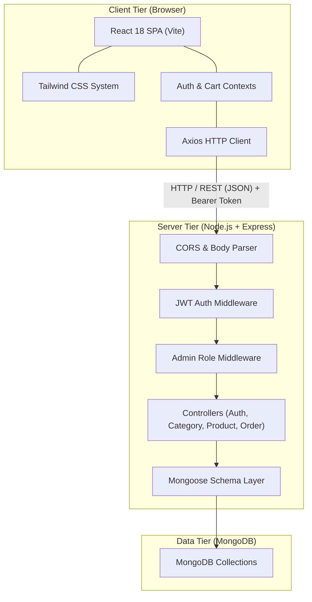
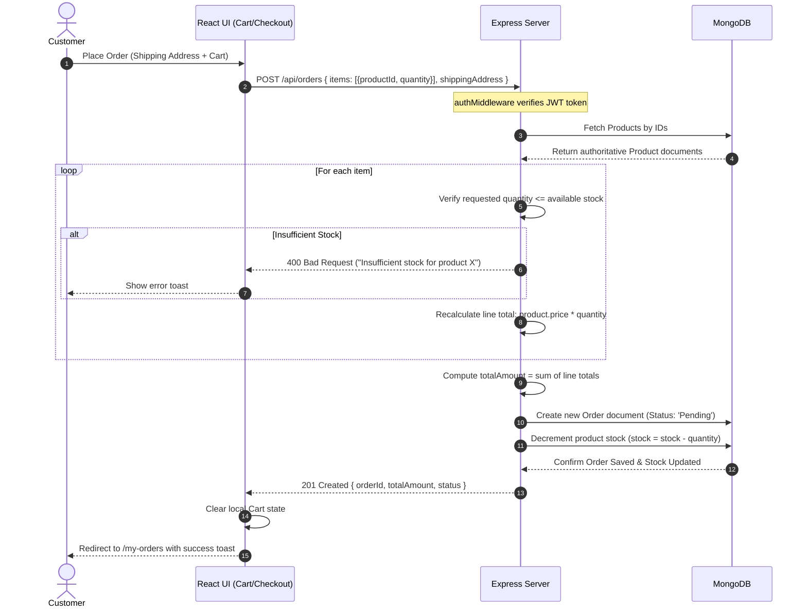

# 🏛️ System Architecture

This document defines the high-level architecture, module decomposition, request lifecycle, and data flow for the **Mini E-Commerce Demo Project (MERN Stack)**.

---

## 1. Architectural Overview

The system follows a decoupled **Client-Server Architecture**:
- **Client Tier**: Single Page Application (SPA) powered by **React.js (Vite)**, styled using **Tailwind CSS**, and utilizing **Axios** for API communication.
- **Server Tier**: RESTful API service built on **Node.js** and **Express.js**, enforcing statelessness, token authentication, and data validation.
- **Database Tier**: Document database hosted on **MongoDB**, accessed through the **Mongoose** Object Data Modeling (ODM) library.



---

## 2. Directory Layout & Module Structure

The project enforces strict separation of concerns into `/client` and `/server`.

### 2.1 Backend (`/server`)

```text
server/
├── config/
│   └── db.js                 # MongoDB connection logic via mongoose.connect
├── controllers/
│   ├── authController.js     # User registration, login, token generation
│   ├── categoryController.js # Category CRUD operations
│   ├── productController.js  # Product CRUD, category filtering & text search
│   └── orderController.js    # Order placement, price validation, stock reduction, status updates
├── middleware/
│   ├── authMiddleware.js     # Extracts & verifies JWT token from Authorization header
│   ├── adminMiddleware.js    # Enforces role === 'admin'
│   └── errorHandler.js       # Global error response formatting
├── models/
│   ├── User.js               # User schema (name, email, password, role)
│   ├── Category.js           # Category schema (name, description)
│   ├── Product.js            # Product schema (name, price, stock, category, image)
│   └── Order.js              # Order schema (user, products, shippingAddress, totalAmount, status)
├── routes/
│   ├── authRoutes.js         # /api/auth routes
│   ├── categoryRoutes.js     # /api/categories routes
│   ├── productRoutes.js      # /api/products routes
│   ├── orderRoutes.js        # /api/orders routes (customer & order creation)
│   └── adminOrderRoutes.js   # /api/admin/orders routes
├── package.json
└── server.js                 # Express application initialization & middleware registration
```

### 2.2 Frontend (`/client`)

```text
client/
├── src/
│   ├── api/
│   │   └── axiosInstance.js      # Axios instance with baseURL & JWT Bearer interceptor
│   ├── context/
│   │   ├── AuthContext.jsx       # Global user authentication state (user, token, login, logout)
│   │   └── CartContext.jsx       # Shopping cart state (items, quantity, totals, stock limits)
│   ├── components/
│   │   ├── common/
│   │   │   ├── Navbar.jsx        # Sticky navigation with cart badge & auth links
│   │   │   ├── Footer.jsx        # Standard application footer
│   │   │   ├── Modal.jsx         # Accessible modal for confirmation/forms
│   │   │   ├── Toast.jsx         # Notification alerts (success, error, warning)
│   │   │   └── ProtectedRoute.jsx# Route guard for authenticated & admin users
│   │   ├── admin/
│   │   │   └── AdminSidebar.jsx  # Admin panel navigation sidebar
│   │   └── product/
│   │       ├── ProductCard.jsx   # Product display card with image, price, stock badge
│   │       └── CategoryFilter.jsx# Horizontal category pills (All | Electronics | ...)
│   ├── pages/
│   │   ├── Home.jsx              # Landing page with hero banner & featured items
│   │   ├── Products.jsx          # Catalog page with filter and search
│   │   ├── ProductDetails.jsx    # Single product view with quantity controls
│   │   ├── Cart.jsx              # Cart page with line items & total calculation
│   │   ├── Checkout.jsx          # Shipping address form & COD confirmation
│   │   ├── Login.jsx             # User & Admin login form
│   │   ├── Register.jsx          # Customer registration form
│   │   ├── MyOrders.jsx          # Customer order history list
│   │   └── admin/
│   │       ├── AdminDashboard.jsx# Summary counters (Orders, Products, Categories)
│   │       ├── AdminCategories.jsx# Category table + Add/Edit modal
│   │       ├── AdminProducts.jsx # Product table + Add/Edit modal
│   │       └── AdminOrders.jsx   # Order table + Status dropdown controller
│   ├── App.jsx                   # React Router route definitions
│   ├── index.css                 # Tailwind CSS directives
│   └── main.jsx                  # React DOM mount point with Context Providers
├── index.html
├── package.json
├── tailwind.config.js
└── vite.config.js
```

---

## 3. Communication & Data Flow

### 3.1 Public Storefront Browsing

1. When a user navigates to `/products`:
   - React invokes `axiosInstance.get('/api/products?category=...&search=...')`.
   - Express handles the query in `productController.getProducts`, building a dynamic Mongoose filter:
     ```javascript
     const filter = {};
     if (category) filter.category = categoryId;
     if (search) filter.name = { $regex: search, $options: 'i' };
     ```
   - MongoDB returns matched product documents populated with category info.
   - React updates the local state and renders the `ProductCard` grid.

### 3.2 Secure Order Placement Flow



---

## 4. Key Design Decisions

| Decision | Rationale |
| :--- | :--- |
| **No Payment Gateway Integration** | Focus remains strictly on core MERN architecture, eliminating third-party webhook complexity. Cash on Delivery (COD) models real-world inventory decrements cleanly. |
| **Server-Side Price Calculation** | Essential security rule: Never trust client-submitted prices (`req.body.price`). All line items and totals are computed from live MongoDB records. |
| **JWT Stateless Authentication** | Allows the server to remain completely stateless. Client sends `Bearer <token>` in Axios headers, verified cryptographically by Express. |
| **Atomic Inventory Updates** | Products have stock decremented upon successful order creation, preventing overselling. |
