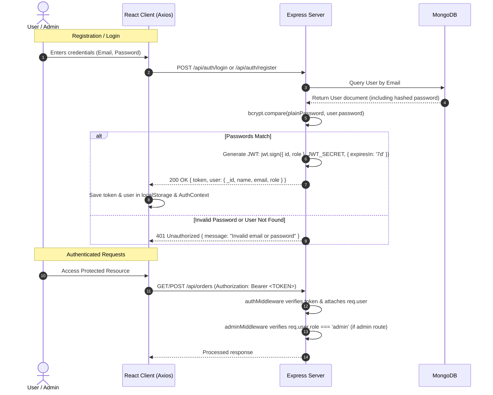

# 🔐 Authentication & Security Specification

This document details the authentication architecture, role-based authorization, middleware implementations, and security validation rules for the **Mini E-Commerce Demo Project**.

---

## 1. Authentication Architecture (JWT + bcrypt)

Stateless authentication using JSON Web Tokens (JWT) signed with a server-side secret key (`JWT_SECRET`).



---

## 2. Roles & Permissions Matrix

The system differentiates between two user roles: `customer` and `admin`.

| Endpoint | Method | Public | Customer | Admin |
| :--- | :---: | :---: | :---: | :---: |
| `/api/auth/register` | `POST` | ✅ | ✅ | ✅ |
| `/api/auth/login` | `POST` | ✅ | ✅ | ✅ |
| `/api/categories` | `GET` | ✅ | ✅ | ✅ |
| `/api/categories` | `POST` | ❌ | ❌ | ✅ |
| `/api/categories/:id` | `PUT` | ❌ | ❌ | ✅ |
| `/api/categories/:id` | `DELETE` | ❌ | ❌ | ✅ |
| `/api/products` | `GET` | ✅ | ✅ | ✅ |
| `/api/products/:id` | `GET` | ✅ | ✅ | ✅ |
| `/api/products` | `POST` | ❌ | ❌ | ✅ |
| `/api/products/:id` | `PUT` | ❌ | ❌ | ✅ |
| `/api/products/:id` | `DELETE` | ❌ | ❌ | ✅ |
| `/api/orders` | `POST` | ❌ | ✅ | ✅ |
| `/api/orders/my-orders` | `GET` | ❌ | ✅ | ✅ |
| `/api/admin/orders` | `GET` | ❌ | ❌ | ✅ |
| `/api/admin/orders/:id/status` | `PATCH` | ❌ | ❌ | ✅ |

---

## 3. Middleware Implementation Reference

### 3.1 `authMiddleware.js` (Token Verification)

Extracts the Bearer token from the `Authorization` header, verifies validity, and populates `req.user`.

```javascript
const jwt = require('jsonwebtoken');
const User = require('../models/User');

const protect = async (req, res, next) => {
  let token;

  if (
    req.headers.authorization &&
    req.headers.authorization.startsWith('Bearer ')
  ) {
    try {
      token = req.headers.authorization.split(' ')[1];
      const decoded = jwt.verify(token, process.env.JWT_SECRET);
      
      // Fetch user without password field
      req.user = await User.findById(decoded.id).select('-password');
      if (!req.user) {
        return res.status(401).json({ success: false, message: 'User no longer exists' });
      }

      next();
    } catch (error) {
      return res.status(401).json({ success: false, message: 'Not authorized, token failed' });
    }
  }

  if (!token) {
    return res.status(401).json({ success: false, message: 'Not authorized, no token provided' });
  }
};

module.exports = { protect };
```

### 3.2 `adminMiddleware.js` (Role Check)

Requires that `req.user` exists (must run after `protect`) and has `role === 'admin'`.

```javascript
const adminOnly = (req, res, next) => {
  if (req.user && req.user.role === 'admin') {
    next();
  } else {
    res.status(403).json({
      success: false,
      message: 'Access denied: Requires administrator privileges',
    });
  }
};

module.exports = { adminOnly };
```

---

## 4. Key Security Principles & Validation Rules

### 4.1 Price Integrity Rule (CRITICAL)
> **Never trust product prices sent from the client.**
- Attack vector: A malicious user modifies client JavaScript or Axios payloads to submit a product price of `$0.01` instead of `$699.99`.
- **Defense Mechanism**:
  1. The client only submits an array of `{ productId, quantity }`.
  2. The server queries the database for each `productId`.
  3. The server computes the line item total: `lineTotal = dbProduct.price * quantity`.
  4. The server calculates the authoritative `totalAmount = sum(lineTotal)`.
  5. The snapshot saved in the `Order` record reflects the verified database price.

### 4.2 Stock Validation & Decrement
- Before creating an order, verify `quantity <= dbProduct.stock` for every item.
- If any product lacks adequate stock, abort the operation immediately and return a `400 Bad Request` with the item name.
- Upon successful order creation, atomically decrement stock in MongoDB:
  ```javascript
  await Product.findByIdAndUpdate(item.productId, {
    $inc: { stock: -item.quantity }
  });
  ```

### 4.3 Input Validation Standards
- **Email Validation**: Standard regex verification; checked for uniqueness in database.
- **Password Strength**: Minimum 6 characters required on both client and server.
- **Product Price**: Must be numeric and greater than 0 (`min: 0.01`).
- **Product Stock**: Must be an integer greater than or equal to 0 (`min: 0`).
- **Category Reference**: Must be a valid 24-character hexadecimal MongoDB ObjectId that exists in the database.
- **Shipping Address**: All fields (`name`, `phone`, `address`, `city`, `pincode`) are trimmed and verified non-empty.

### 4.4 Password Hashing Standard
- Utilizes `bcryptjs` with a work factor (salt rounds) of `10`.
- Passwords are never saved or queried in plaintext (`select: false` on Mongoose schema).
