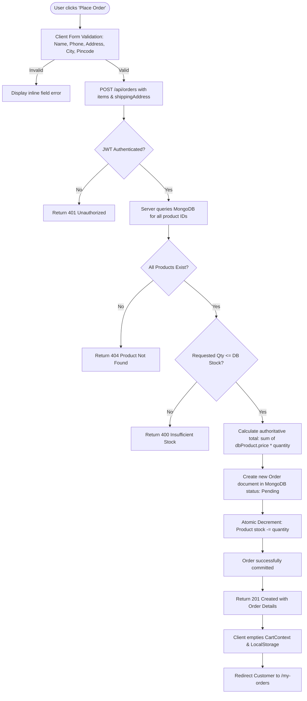
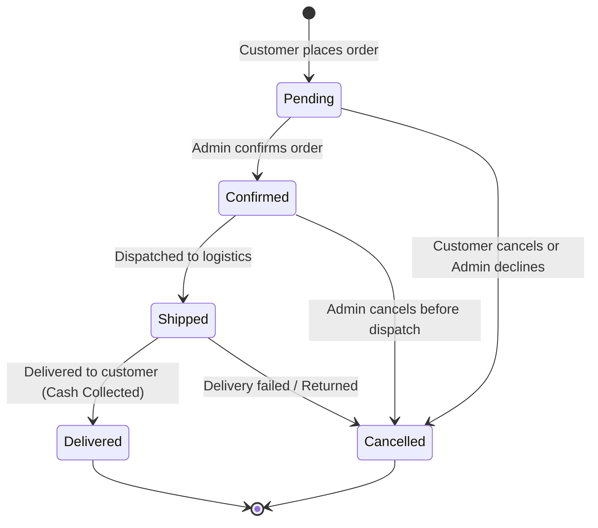

# 📦 Checkout, Inventory & Orders Lifecycle

This document provides a detailed breakdown of the checkout flow, stock reduction logic, order state transitions, and server-side data verification.

---

## 1. Checkout Workflow & Architecture

The checkout process employs a strict, transactional verification cycle to prevent overselling, race conditions, and client-side price tampering.



---

## 2. Order Creation Sequence: Step-by-Step

### Step 1: Client Payload Construction
The client only transmits the product references, requested quantities, and recipient information:
```json
{
  "items": [
    { "productId": "65b9e201a01f9c0012345680", "quantity": 2 },
    { "productId": "65b9e202a01f9c0012345681", "quantity": 1 }
  ],
  "shippingAddress": {
    "name": "Alex Mercer",
    "phone": "+1-555-0199",
    "address": "742 Evergreen Terrace",
    "city": "Springfield",
    "pincode": "97477"
  }
}
```
*Note: Any `price` field sent in the payload is deliberately ignored by the backend.*

---

### Step 2: Server-Side Product Validation & Pricing
The backend controller processes the order payload:

```javascript
// Sample orderController logic
exports.createOrder = async (req, res) => {
  const { items, shippingAddress } = req.body;

  if (!items || items.length === 0) {
    return res.status(400).json({ success: false, message: 'Cart is empty' });
  }

  // 1. Extract IDs and fetch live products from database
  const productIds = items.map((i) => i.productId);
  const dbProducts = await Product.find({ _id: { $in: productIds } });

  if (dbProducts.length !== productIds.length) {
    return res.status(404).json({ success: false, message: 'One or more products not found' });
  }

  // 2. Validate stock and calculate verified totals
  let calculatedTotal = 0;
  const orderLineItems = [];

  for (const item of items) {
    const product = dbProducts.find((p) => p._id.toString() === item.productId);

    if (item.quantity > product.stock) {
      return res.status(400).json({
        success: false,
        message: `Insufficient stock for "${product.name}". Available: ${product.stock}`,
      });
    }

    const lineTotal = product.price * item.quantity;
    calculatedTotal += lineTotal;

    orderLineItems.push({
      product: product._id,
      name: product.name,
      price: product.price, // Live database price snapshot
      quantity: item.quantity,
    });
  }

  // 3. Persist Order document
  const newOrder = await Order.create({
    user: req.user._id,
    products: orderLineItems,
    totalAmount: Math.round(calculatedTotal * 100) / 100,
    shippingAddress,
    status: 'Pending',
    createdAt: new Date(),
  });

  // 4. Decrement inventory stock atomically
  for (const item of items) {
    await Product.findByIdAndUpdate(item.productId, {
      $inc: { stock: -item.quantity },
    });
  }

  res.status(201).json({
    success: true,
    message: 'Order created successfully via Cash on Delivery',
    order: newOrder,
  });
};
```

---

## 3. Order Status State Machine

Orders progress through a defined linear state machine managed by Administrators:



### Allowed Status Transitions

| Status | Next Allowed Transitions | Description |
| :--- | :--- | :--- |
| `Pending` | `Confirmed`, `Cancelled` | Initial state upon checkout creation |
| `Confirmed` | `Shipped`, `Cancelled` | Order verified and being packed |
| `Shipped` | `Delivered`, `Cancelled` | Package in transit with courier |
| `Delivered` | *(Terminal)* | Customer received package & paid cash |
| `Cancelled` | *(Terminal)* | Order cancelled; stock can optionally be returned |

---

## 4. Customer vs. Admin Views

### 4.1 Customer Storefront ("My Orders")
- Read-only list populated via `GET /api/orders/my-orders`.
- Only includes orders where `order.user === req.user._id`.
- Visual cards displaying status pills:
  - Yellow badge for `Pending`
  - Blue badge for `Confirmed`
  - Indigo badge for `Shipped`
  - Green badge for `Delivered`
  - Red badge for `Cancelled`

### 4.2 Admin Panel ("Admin Orders")
- Full list of all orders across every customer via `GET /api/admin/orders`.
- Includes populated customer information (`user.name`, `user.email`).
- Allows in-place status modification via interactive dropdown triggering `PATCH /api/admin/orders/:id/status`.
