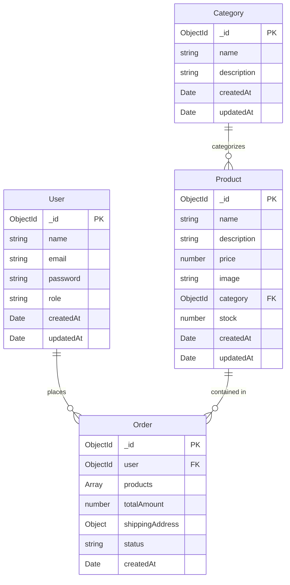

# 🗄️ MongoDB Database Models

This document defines the schema definitions, relationships, constraints, and Mongoose configurations for the **4 required models**: `User`, `Category`, `Product`, and `Order`.

---

## 1. Entity Relationship (ER) Diagram



---

## 2. Model 1: User (`server/models/User.js`)

Manages both Customer and Admin identities with role-based attributes and password hashing.

### 2.1 Field Specifications

| Field | Type | Required | Constraints / Defaults | Description |
| :--- | :--- | :--- | :--- | :--- |
| `name` | `String` | Yes | Trimmed, max 60 chars | Full name of the user |
| `email` | `String` | Yes | Unique, lowercase, valid email regex | Unique login email |
| `password` | `String` | Yes | Min length 6 | Hashed via bcrypt |
| `role` | `String` | Yes | Enum: `['customer', 'admin']`, Default: `'customer'` | Authorization role |
| `createdAt` | `Date` | Auto | Mongoose timestamps | Creation timestamp |
| `updatedAt` | `Date` | Auto | Mongoose timestamps | Last updated timestamp |

### 2.2 Schema Code Reference

```javascript
const mongoose = require('mongoose');
const bcrypt = require('bcryptjs');

const userSchema = new mongoose.Schema(
  {
    name: {
      type: String,
      required: [true, 'Please provide your name'],
      trim: true,
      maxlength: [60, 'Name cannot exceed 60 characters'],
    },
    email: {
      type: String,
      required: [true, 'Please provide your email'],
      unique: true,
      lowercase: true,
      trim: true,
      match: [
        /^\w+([\.-]?\w+)*@\w+([\.-]?\w+)*(\.\w{2,3})+$/,
        'Please enter a valid email address',
      ],
    },
    password: {
      type: String,
      required: [true, 'Please provide a password'],
      minlength: [6, 'Password must be at least 6 characters long'],
      select: false, // Prevents password from leaking in queries
    },
    role: {
      type: String,
      enum: ['customer', 'admin'],
      default: 'customer',
    },
  },
  { timestamps: true }
);

// Pre-save hook to hash password with bcrypt
userSchema.pre('save', async function (next) {
  if (!this.isModified('password')) return next();
  const salt = await bcrypt.genSalt(10);
  this.password = await bcrypt.hash(this.password, salt);
  next();
});

// Instance method to compare candidate password with hash
userSchema.methods.comparePassword = async function (candidatePassword) {
  return await bcrypt.compare(candidatePassword, this.password);
};

module.exports = mongoose.model('User', userSchema);
```

---

## 3. Model 2: Category (`server/models/Category.js`)

Organizes products into logical storefront collections.

### 3.1 Field Specifications

| Field | Type | Required | Constraints / Defaults | Description |
| :--- | :--- | :--- | :--- | :--- |
| `name` | `String` | Yes | Unique, trimmed, max 50 chars | Category title (e.g., Electronics) |
| `description` | `String` | No | Trimmed, max 255 chars | Short summary of the category |
| `createdAt` | `Date` | Auto | Mongoose timestamps | Creation timestamp |
| `updatedAt` | `Date` | Auto | Mongoose timestamps | Last updated timestamp |

### 3.2 Schema Code Reference

```javascript
const mongoose = require('mongoose');

const categorySchema = new mongoose.Schema(
  {
    name: {
      type: String,
      required: [true, 'Category name is required'],
      unique: true,
      trim: true,
      maxlength: [50, 'Category name cannot exceed 50 characters'],
    },
    description: {
      type: String,
      trim: true,
      maxlength: [255, 'Description cannot exceed 255 characters'],
      default: '',
    },
  },
  { timestamps: true }
);

module.exports = mongoose.model('Category', categorySchema);
```

---

## 4. Model 3: Product (`server/models/Product.js`)

Stores item metadata, inventory stock level, and category reference.

### 4.1 Field Specifications

| Field | Type | Required | Constraints / Defaults | Description |
| :--- | :--- | :--- | :--- | :--- |
| `name` | `String` | Yes | Trimmed, max 120 chars | Product name |
| `description`| `String` | Yes | Trimmed | Detailed product description |
| `price` | `Number` | Yes | Min: `0.01` (Positive only) | Product price in USD / Currency |
| `image` | `String` | Yes | Valid URL string | Hosted image URL |
| `category` | `ObjectId` | Yes | Ref: `'Category'` | Foreign key reference to Category |
| `stock` | `Number` | Yes | Integer, Min: `0`, Default: `0` | Available inventory quantity |
| `createdAt` | `Date` | Auto | Mongoose timestamps | Creation timestamp |
| `updatedAt` | `Date` | Auto | Mongoose timestamps | Last updated timestamp |

### 4.2 Schema Code Reference

```javascript
const mongoose = require('mongoose');

const productSchema = new mongoose.Schema(
  {
    name: {
      type: String,
      required: [true, 'Product name is required'],
      trim: true,
      maxlength: [120, 'Product name cannot exceed 120 characters'],
    },
    description: {
      type: String,
      required: [true, 'Product description is required'],
      trim: true,
    },
    price: {
      type: Number,
      required: [true, 'Product price is required'],
      min: [0.01, 'Price must be a positive number'],
    },
    image: {
      type: String,
      required: [true, 'Product image URL is required'],
      trim: true,
    },
    category: {
      type: mongoose.Schema.Types.ObjectId,
      ref: 'Category',
      required: [true, 'Category reference is required'],
    },
    stock: {
      type: Number,
      required: [true, 'Stock count is required'],
      min: [0, 'Stock cannot be negative'],
      default: 0,
      validate: {
        validator: Number.isInteger,
        message: '{VALUE} is not an integer stock value',
      },
    },
  },
  { timestamps: true }
);

// Text index for search
productSchema.index({ name: 'text', description: 'text' });

module.exports = mongoose.model('Product', productSchema);
```

---

## 5. Model 4: Order (`server/models/Order.js`)

Stores order records, purchased snapshot line items, address details, and status.

### 5.1 Field Specifications

| Field | Type | Required | Description |
| :--- | :--- | :--- | :--- |
| `user` | `ObjectId` | Yes | Ref: `'User'` — user who placed the order |
| `products` | `Array` | Yes | Array of purchased line items (snapshot of `product`, `name`, `price`, `quantity`) |
| `totalAmount`| `Number` | Yes | Authoritative sum calculated on backend from live DB prices |
| `shippingAddress` | `Object` | Yes | Subdocument with `name`, `phone`, `address`, `city`, `pincode` |
| `status` | `String` | Yes | Enum: `['Pending', 'Confirmed', 'Shipped', 'Delivered', 'Cancelled']`, Default: `'Pending'` |
| `createdAt` | `Date` | Auto | Default: `Date.now` |

### 5.2 Schema Code Reference

```javascript
const mongoose = require('mongoose');

const orderItemSchema = new mongoose.Schema({
  product: {
    type: mongoose.Schema.Types.ObjectId,
    ref: 'Product',
    required: true,
  },
  name: {
    type: String,
    required: true,
  },
  price: {
    type: Number,
    required: true,
  },
  quantity: {
    type: Number,
    required: true,
    min: [1, 'Quantity must be at least 1'],
  },
});

const shippingAddressSchema = new mongoose.Schema({
  name: { type: String, required: [true, 'Recipient name is required'], trim: true },
  phone: { type: String, required: [true, 'Phone number is required'], trim: true },
  address: { type: String, required: [true, 'Street address is required'], trim: true },
  city: { type: String, required: [true, 'City is required'], trim: true },
  pincode: { type: String, required: [true, 'Pincode / Postal code is required'], trim: true },
});

const orderSchema = new mongoose.Schema({
  user: {
    type: mongoose.Schema.Types.ObjectId,
    ref: 'User',
    required: [true, 'Order must belong to a user'],
  },
  products: {
    type: [orderItemSchema],
    validate: [
      (val) => val.length > 0,
      'Order must contain at least one product',
    ],
  },
  totalAmount: {
    type: Number,
    required: [true, 'Total amount is required'],
    min: [0, 'Total amount cannot be negative'],
  },
  shippingAddress: {
    type: shippingAddressSchema,
    required: true,
  },
  status: {
    type: String,
    enum: ['Pending', 'Confirmed', 'Shipped', 'Delivered', 'Cancelled'],
    default: 'Pending',
  },
  createdAt: {
    type: Date,
    default: Date.now,
  },
});

module.exports = mongoose.model('Order', orderSchema);
```
