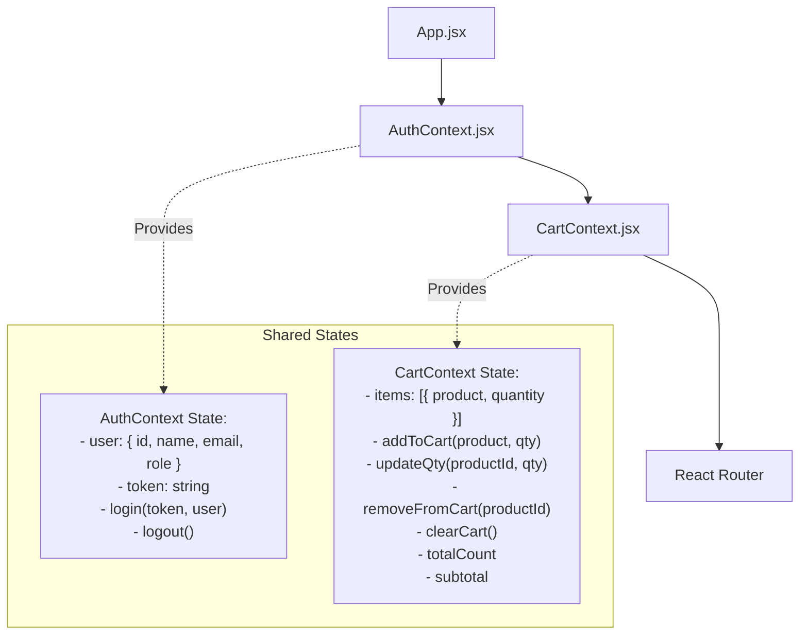

# 🎨 Frontend Specification (React + Vite + Tailwind CSS)

This document details the UI/UX architecture, component hierarchy, page layouts, state management, and design system for the **Mini E-Commerce Demo Project**.

---

## 1. Design System & Styling (Tailwind CSS)

### 1.1 Color Palette & Theme Tokens
The interface adopts a clean, modern, and professional aesthetic using Tailwind's slate/indigo neutral palette:
- **Primary / Brand**: `indigo-600` (Hover: `indigo-700`, Active: `indigo-800`, Light: `indigo-50`)
- **Background**: `bg-gray-50` (Page Canvas), `bg-white` (Cards & Modals)
- **Text**: `text-gray-900` (Headings), `text-gray-600` (Body Copy), `text-gray-400` (Muted/Placeholders)
- **Borders & Dividers**: `border-gray-200`
- **Feedback & Badges**:
  - Success / Delivered: `emerald-600` / `bg-emerald-50 text-emerald-700`
  - Shipped / In-Transit: `blue-600` / `bg-blue-50 text-blue-700`
  - Pending / Warning: `amber-600` / `bg-amber-50 text-amber-700`
  - Cancelled / Danger: `rose-600` / `bg-rose-50 text-rose-700`

### 1.2 Core UI Patterns
- **Cards**: `bg-white rounded-xl shadow-sm border border-gray-100 overflow-hidden hover:shadow-md transition`
- **Buttons**:
  - Primary: `px-4 py-2 bg-indigo-600 hover:bg-indigo-700 text-white font-medium rounded-lg transition duration-150 shadow-sm`
  - Secondary: `px-4 py-2 bg-white border border-gray-300 text-gray-700 hover:bg-gray-50 rounded-lg transition`
  - Danger: `px-4 py-2 bg-rose-600 hover:bg-rose-700 text-white rounded-lg transition`
- **Form Inputs**: `w-full px-3.5 py-2.5 bg-white border border-gray-300 rounded-lg text-gray-900 placeholder-gray-400 focus:outline-none focus:ring-2 focus:ring-indigo-500 focus:border-indigo-500`

---

## 2. Global State Management

Global state is handled cleanly using React Context API to avoid unnecessary external state libraries.

### 2.1 Cart Stock Boundary Rules
In `CartContext.jsx`:
- When adding an item to the cart, check if `existingQty + addedQty <= product.stock`. If it exceeds stock, cap the quantity and display a warning toast: `"Cannot add more than available stock (X available)"`.
- Disable the `+` increment button whenever `item.quantity >= item.product.stock`.
- Disable the "Add to Cart" button when `product.stock === 0` (Out of Stock).

---

## 3. Public Storefront Pages

### 3.1 Page Hierarchy & Routes

| Path | Component | Description | Access |
| :--- | :--- | :--- | :--- |
| `/` | `Home.jsx` | Hero banner, category highlights, latest arrivals | Public |
| `/products` | `Products.jsx` | Filterable catalog with search bar and category pills | Public |
| `/products/:id` | `ProductDetails.jsx` | Full item view, stock badge, quantity picker | Public |
| `/cart` | `Cart.jsx` | Cart items table, quantity modifier, subtotal | Public |
| `/checkout` | `Checkout.jsx` | Shipping address form & Cash on Delivery confirmation | Auth |
| `/login` | `Login.jsx` | Unified login form (Customer & Admin) | Public |
| `/register` | `Register.jsx` | Customer registration form | Public |
| `/my-orders` | `MyOrders.jsx` | Order history list with items and live status | Auth |

---

### 3.2 Page Layouts & Feature Specs

#### A. Products Catalog (`Products.jsx`)
- **Category Filter Pills**: Horizontal scrollable/wrapped pill buttons:
  `[ All ] [ Electronics ] [ Fashion ] [ Shoes ]`
  Clicking a category pill filters the products dynamically without full-page reload.
- **Search Input**: Debounced search bar with instant query param updates (`?search=query`).
- **Product Card (`ProductCard.jsx`)**:
  - Image thumbnail with fallback
  - Category pill badge
  - Product title (clamped to 2 lines)
  - Price display (`$XX.XX`)
  - Stock indicator (`X in stock` or `Out of Stock`)
  - "Add to Cart" button (disabled when stock is 0)

#### B. Cart Page (`Cart.jsx`)
- Clean table/card view showing:
  - Product image and title
  - Unit price
  - Quantity adjuster: `[-] [Quantity input] [+]` (capped by product stock)
  - Line total: `unitPrice * quantity`
  - Remove button with trash icon
- **Order Summary Sidebar**:
  - Items Subtotal
  - Shipping fee (Free / COD)
  - Total Amount
  - "Proceed to Checkout" button

#### C. Checkout Page (`Checkout.jsx`)
- Shipping address form:
  - Full Name (`name`)
  - Phone Number (`phone`)
  - Street Address (`address`)
  - City (`city`)
  - Pincode / Postal Code (`pincode`)
- Payment Method selector:
  - **Cash on Delivery (COD)** (Pre-selected and locked)
- "Place Order" button with loading spinner during processing.

#### D. My Orders (`MyOrders.jsx`)
- Displays all orders for the logged-in customer sorted newest first.
- Each order card contains:
  - Order ID & Creation date
  - Colored Status Badge (`Pending`, `Confirmed`, `Shipped`, `Delivered`, `Cancelled`)
  - Line items breakdown with thumbnail, product name, quantity, and unit price
  - Shipping address snapshot
  - Total paid/due amount

---

## 4. Admin Panel Specification

The Admin Panel is separated into a dedicated route tree (`/admin/*`) guarded by `ProtectedRoute` verifying `user.role === 'admin'`.

### 4.1 Admin Route Tree

| Path | Component | Description |
| :--- | :--- | :--- |
| `/admin` | `AdminDashboard.jsx` | Metric summary cards (Total Orders, Products, Categories) |
| `/admin/categories` | `AdminCategories.jsx` | Category data table with Add/Edit/Delete actions |
| `/admin/products` | `AdminProducts.jsx` | Product inventory table with Add/Edit/Delete actions |
| `/admin/orders` | `AdminOrders.jsx` | Customer order fulfillment table with status updater |

### 4.2 Admin UI Components

#### A. Admin Layout (`AdminSidebar.jsx`)
- Fixed/collapsible left sidebar containing:
  - Store Logo / Brand
  - Navigation links: `Dashboard`, `Categories`, `Products`, `Orders`
  - "Back to Store" link
  - Admin Profile & Logout button

#### B. Categories Management (`AdminCategories.jsx`)
- Responsive data table: `Name`, `Description`, `Created Date`, `Actions (Edit / Delete)`.
- "Add Category" button opens modal form:
  - Name (required)
  - Description (optional)
- "Delete Category" triggers a confirmation modal dialog before making `DELETE /api/categories/:id`.

#### C. Products Management (`AdminProducts.jsx`)
- Data table: `Image`, `Product Name`, `Category`, `Price`, `Stock`, `Actions (Edit / Delete)`.
- Low-stock badge when `stock < 5`.
- "Add/Edit Product" modal form:
  - Name
  - Category (dropdown populated from `GET /api/categories`)
  - Price ($)
  - Stock count
  - Image URL
  - Description

#### D. Orders Management (`AdminOrders.jsx`)
- Data table: `Order ID`, `Customer Name & Email`, `Date`, `Total Amount`, `Items Count`, `Status`, `Actions`.
- "View Details" modal showing shipping address and individual line items.
- Status Dropdown Selector directly on the table or modal:
  `[ Pending ▾ ]`
  Options: `Pending`, `Confirmed`, `Shipped`, `Delivered`, `Cancelled`.
  Triggers `PATCH /api/admin/orders/:id/status`.

---

## 5. Micro-Interactions & UX Requirements

- **Toast Notifications**: Lightweight, auto-dismissing toast alerts for:
  - Item added to cart
  - Quantity adjusted
  - Stock limit warnings
  - Order placed successfully
  - Category/Product created, updated, or deleted
  - Login/Register errors
- **Loading States**: Skeleton loaders or spinner overlays on API calls to prevent UI jumping.
- **Empty States**: Friendly illustrations/messages when:
  - The cart is empty (with a "Start Shopping" button)
  - No products match the search or category filter
  - No orders have been placed yet
- **Delete Confirmation Modal**: Accessible modal dialog asking: `"Are you sure you want to delete this product? This action cannot be undone."` with `Cancel` and `Confirm Delete` buttons.
